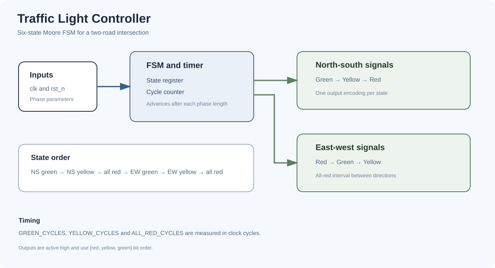
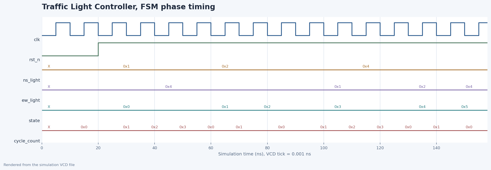

# Traffic Light Controller

This project uses a six-state Moore finite state machine to control a simple two-road intersection. North-south and east-west traffic take turns, with an all-red interval between directions.

The phase lengths are parameters measured in clock cycles. Short values in the testbench make the full sequence easy to inspect.



## Interface

| Signal | Direction | Description |
| --- | --- | --- |
| `clk` | Input | System clock |
| `rst_n` | Input | Active-low asynchronous reset |
| `ns_light[2:0]` | Output | North-south red, yellow, green |
| `ew_light[2:0]` | Output | East-west red, yellow, green |

The outputs are active high. The bit order is red, yellow, green.

## Run it

Install Icarus Verilog and Python with Matplotlib. From the repository folder, run:

```bash
bash scripts/run_sim.sh
```

The testbench checks the reset state, the programmed length of each phase, and one complete sequence back to north-south green.

## Simulation output

The waveform is generated from the VCD written by the testbench.



[Open the VCD file](docs/waveforms/traffic_light_controller.vcd) · [Read the simulation log](docs/waveforms/simulation.log)

## What is not covered

This is a fixed sequence. It does not use vehicle sensors or pedestrian requests, and it has no emergency override or adaptive timing.

Sai Teja
